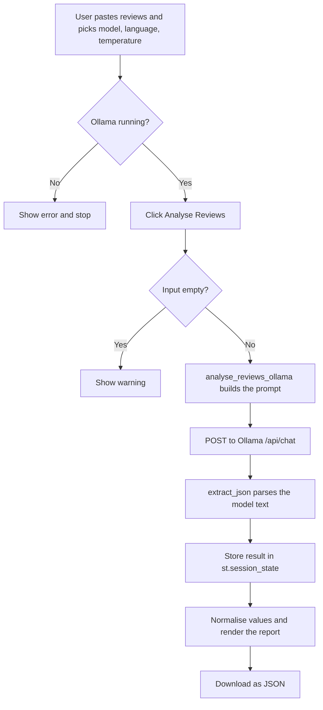

# 🤖 Customer Review Analyzer

A Streamlit app that turns raw customer reviews into a structured business report using a **local LLM served by Ollama**. No API key, no cloud service, and your review text never leaves your machine.

Paste a batch of reviews, click **Analyse Reviews**, and get the overall sentiment, an estimated rating, top positives and negatives, customer pain points, business suggestions and keywords. The report can be downloaded as JSON.

## Features

- Runs fully locally through [Ollama](https://ollama.com), with no API keys and no data sent to third parties
- Converts unstructured text into a fixed JSON report through prompt design
- Output in **English, Telugu or Tenglish**
- Choose the model (`qwen2.5:3b`, `llama3.2:1b`, `llama3.2`, `mistral`) and the temperature
- Defensive JSON parsing and output normalisation, so small models don't crash the app
- One-click JSON export

## How it works



A detailed walkthrough of every step and method is in [`docs/Project_Documentation.docx`](docs/Project_Documentation.docx).

## Tech stack

| Component | Purpose |
|---|---|
| Python 3.9+ | Core language |
| Streamlit | Web app framework and session state |
| requests | HTTP calls to the Ollama REST API |
| Ollama | Local model server (`/api/chat`) |
| `json`, `re`, `html` | Parsing model output and safely escaping text |

## Getting started

### 1. Install Ollama and pull a model

Install Ollama from [ollama.com/download](https://ollama.com/download), then pull the default model:

```bash
ollama pull qwen2.5:3b
```

Make sure the Ollama server is running (the desktop app starts it automatically; otherwise run `ollama serve`).

### 2. Clone the repository and install dependencies

```bash
git clone https://github.com/<your-username>/customer-review-analyzer.git
cd customer-review-analyzer

python -m venv venv
# Windows:
venv\Scripts\activate
# macOS / Linux:
source venv/bin/activate

pip install -r requirements.txt
```

### 3. Run the app

```bash
streamlit run main.py
```

The app opens at `http://localhost:8501`.

## Usage

1. Pick a model, output language and temperature in the sidebar.
2. Paste customer reviews, **one per line**. You can use [`sample_reviews.txt`](sample_reviews.txt) to try it out.
3. Click **Analyse Reviews**.
4. Read the report, or download it as JSON.

## Output format

The model is asked to return JSON with these fields (see [`sample_output.json`](sample_output.json) for an example):

| Field | Type | Meaning |
|---|---|---|
| `overall_sentiment` | string | Positive / Neutral / Negative / Mixed |
| `estimated_rating_out_of_5` | number | AI-estimated rating, clamped to 0 to 5 |
| `one_line_verdict` | string | Short overall verdict |
| `summary` | string | Short paragraph summary |
| `top_positives` | list | What customers like |
| `top_negatives` | list | What customers dislike |
| `customer_pain_points` | list | Recurring problems |
| `business_suggestions` | list | Recommended actions |
| `best_for` | list | Customer types the product suits |
| `keywords` | list | Important terms from the reviews |

## Project structure

```
customer-review-analyzer/
├── main.py                       # Streamlit app: UI, Ollama call, JSON parsing
├── requirements.txt              # Python dependencies
├── sample_reviews.txt            # Sample input for quick testing
├── sample_output.json            # Example of the report format
├── docs/
│   └── Project_Documentation.docx
├── .gitignore
├── LICENSE
└── README.md
```

## Troubleshooting

| Problem | Fix |
|---|---|
| "Ollama is not running" | Start it with `ollama serve` |
| `HTTP Error 404` after clicking Analyse | The model isn't downloaded. Run `ollama pull <model-name>` |
| "Could not parse JSON from model response" | Lower the temperature to 0.1 to 0.2, or try a larger model |
| First request is slow | Ollama is loading the model into memory; later requests are faster |

## Limitations and ideas for improvement

- Small local models don't always follow the JSON format. Ollama's `format: "json"` request option could be used to constrain the output.
- Very long review sets may exceed the model's context window. Batching the reviews would help.
- The rating is an LLM estimate, not a calculated score.
- Possible additions: CSV upload, schema validation (e.g. Pydantic), unit tests for the helper functions, result history.

## License

Released under the [MIT License](LICENSE).
